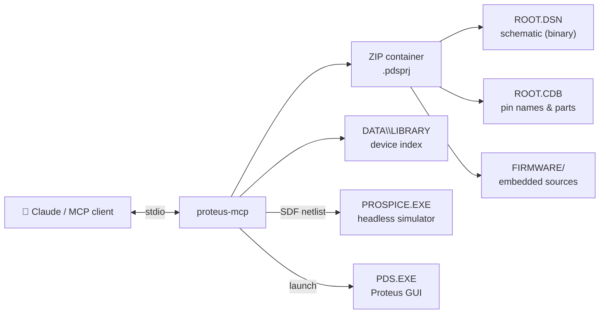

<div align="center">

# ⚡ proteus-mcp

**Give Claude (or any MCP client) hands-on access to your Labcenter Proteus 8 projects.**

Read schematics · trace nets · build BOMs · edit parts · manage firmware · search ~500k library parts · run the simulator headless

[](LICENSE)
[](https://nodejs.org)
[](https://modelcontextprotocol.io)
[](#compatibility)
[](#-tested-against-the-real-thing)

</div>

---

Proteus has **no public automation API**, and its project files (`.pdsprj`) use an
**undocumented binary format**. `proteus-mcp` is built on a from-scratch reverse engineering of
that format, so an AI assistant can work with your circuits directly instead of you clicking
through dialogs.

> 💬 *"Which pins of U1 are unconnected?"*
> 💬 *"Point the microcontroller at `build/app.hex` and set the clock to 16 MHz."*
> 💬 *"Give me a BOM as CSV, grouped by value."*
> 💬 *"Find me a 16×2 I²C LCD in the Proteus library."*
> 💬 *"What is connected to the VCC net?"*

---

## 📑 Contents

- [Features](#-features)
- [Quick start](#-quick-start)
- [Tools](#-tools)
- [How it works](#-how-it-works)
- [Tested against the real thing](#-tested-against-the-real-thing)
- [Limitations & roadmap](#-limitations--roadmap)
- [Editing safely](#-editing-safely)
- [Development](#-development)
- [How it was reverse engineered](#-how-it-was-reverse-engineered)

---

## ✨ Features

| | |
|---|---|
| 🔍 **Understand any design** | Components, values, packages, positions, properties and the full **netlist** rebuilt from the file |
| 🧭 **Trace connections** | Ask what a pin (`U1.P3.2`, `U1.12`) or net (`VCC`) connects to |
| ✏️ **Edit safely** | Change properties (`PROGRAM`, `CLOCK`, …), values and reference designators. Every edit is verified before it is saved |
| 🧾 **BOM & checks** | Bill of materials (JSON/CSV) and design checks: missing firmware files, duplicate refs, dangling nets, unconnected pins |
| 💾 **Firmware** | Read and write source files embedded by VSM Studio / Visual Designer (e.g. Arduino `main.ino`) |
| 📚 **Library search** | Search the ~500,000 devices in your installed Proteus libraries by name, description or category |
| ▶️ **Simulator & GUI** | Export SDF netlists, run Proteus' simulator headless as a design check, open projects in the Proteus GUI |

---

## 🚀 Quick start

**Requirements:** Node.js 18.17+. The library search, simulator and GUI tools also need Proteus 8 on
Windows; the read and edit tools work on any OS.

**1. Install and build**

```bash
git clone https://github.com/Fretzzz/proteus-mcp.git
```

```bash
cd proteus-mcp && npm install && npm run build
```

**2. Connect it to your MCP client**

<details open>
<summary><b>Claude Code</b></summary>

```bash
claude mcp add proteus -- node /absolute/path/to/proteus-mcp/dist/index.js
```

</details>

<details>
<summary><b>Claude Desktop</b></summary>

Add to `claude_desktop_config.json`:

```json
{
  "mcpServers": {
    "proteus": {
      "command": "node",
      "args": ["C:\\absolute\\path\\to\\proteus-mcp\\dist\\index.js"]
    }
  }
}
```

</details>

<details>
<summary><b>Any other MCP client</b></summary>

It is a standard stdio server: run `node dist/index.js`.

</details>

**3. Ask away.** Point the assistant at a `.pdsprj` file and ask about it.

> If Proteus is installed somewhere unusual, set the environment variable `PROTEUS_HOME` to the
> folder that contains `BIN\PDS.EXE`.

---

## 🧰 Tools

<table>
<tr><th>Area</th><th>Tool</th><th>What it does</th></tr>

<tr><td rowspan="2">🖥️ <b>Setup</b></td>
<td><code>proteus_installation</code></td><td>Find the local Proteus install: version, folders, simulator, samples</td></tr>
<tr><td><code>list_projects</code></td><td>Find <code>.pdsprj</code> files in a folder or in the bundled samples</td></tr>

<tr><td rowspan="7">🔍 <b>Read</b></td>
<td><code>project_overview</code></td><td>Sheets, object counts, archive contents, firmware, metadata</td></tr>
<tr><td><code>list_components</code></td><td>Every part with ref, value, device, package, position and properties</td></tr>
<tr><td><code>get_component</code></td><td>One part in full, including each pin's name, number and net</td></tr>
<tr><td><code>get_netlist</code></td><td>Connectivity as JSON, readable text or Proteus SDF</td></tr>
<tr><td><code>trace_net</code></td><td>Everything on the net of a pin or a named net</td></tr>
<tr><td><code>get_bom</code></td><td>Bill of materials, grouped or per part, as JSON or CSV</td></tr>
<tr><td><code>check_design</code></td><td>Missing firmware, duplicate refs, dangling nets, unconnected pins</td></tr>

<tr><td rowspan="3">✏️ <b>Edit</b></td>
<td><code>set_component_properties</code></td><td>Set, add or remove part properties</td></tr>
<tr><td><code>set_component_value</code></td><td>Change a value, e.g. <code>10k</code> → <code>4k7</code></td></tr>
<tr><td><code>rename_component</code></td><td>Change a reference designator, e.g. <code>R7</code> → <code>R2</code></td></tr>

<tr><td rowspan="3">💾 <b>Files</b></td>
<td><code>list_firmware</code></td><td>Embedded firmware projects and their source files</td></tr>
<tr><td><code>read_project_file</code></td><td>Read any file inside the project archive</td></tr>
<tr><td><code>write_project_file</code></td><td>Create or replace text files, e.g. firmware sources</td></tr>

<tr><td>📚 <b>Library</b></td>
<td><code>search_library</code></td><td>Search installed device libraries by name, description, category</td></tr>

<tr><td rowspan="3">▶️ <b>Run</b></td>
<td><code>export_sdf</code></td><td>Write the design as an SDF netlist (Proteus' simulator input)</td></tr>
<tr><td><code>simulate</code></td><td>Headless simulator check: netlist accepted, models load, firmware reads</td></tr>
<tr><td><code>open_in_proteus</code></td><td>Open the project in the Proteus GUI, optionally auto-starting the simulation</td></tr>

<tr><td>🔬 <b>Debug</b></td>
<td><code>inspect_records</code></td><td>Low-level view of decoded records, for extending format support</td></tr>
</table>

**Example output** (`get_netlist`, text format):

```text
GND: C1.1 C2.1 R2.1 U1.GND(20)*
VCC: C3.+ R1.1 U1.$EA$(31) U1.VCC(40)*
#00001: C2.2 U1.XTAL2(18) X1.1
#00002: C1.2 U1.XTAL1(19) X1.2
#00004: LCD1.RS(4) U1.P3.0/RXD(10)

(* = hidden power pin joined by name)
```

---

## ⚙️ How it works



The key finding: **Proteus stores wiring as absolute file positions**. Every component pin holds the
byte position of the wire it touches, and junctions list the wires that meet. Following those
positions gives an exact netlist.

It also makes editing tricky: any change in text length shifts every later record. The editor
**updates all of those positions**, proves it has found every one, and re-checks the connectivity
before saving. The full format write-up is in **[`docs/FORMAT.md`](docs/FORMAT.md)**.

---

## ✅ Tested against the real thing

| Check | Result |
|---|---|
| Sample projects shipped with Proteus that open | **634 / 634** |
| Components · wires · terminals · junctions parsed | 9,485 · 43,558 · 23,789 · 8,530 |
| Length-changing edits verified by re-parsing | **554** succeeded · 78 safely refused · **0 corrupted** |
| Edited files opened in **Proteus 8.13 itself** | ✔ New values shown in Proteus' own *Edit Component* dialog, wiring intact |
| Netlist vs. a hand-checked wiring table | ✔ Exact match |
| Generated netlist run through `PROSPICE.EXE` | ✔ Accepted; 8051 model and HEX firmware load |

Reproduce with `npm run corpus` (needs a local Proteus install).

---

## 🚧 Limitations & roadmap

These are things not yet reverse engineered, not hard limits. They're **planned for the next
development session.**

| | Limitation | Why | Plan |
|---|---|---|---|
| ⏱️ | **`simulate` validates but doesn't produce waveforms** | Run from the command line, Proteus only simulates what a graph or probe requests. Results go to an undocumented binary "LISA partition" file (`.PDF`, not a real PDF). Live simulation (LCD updating, clickable buttons) only exists in the GUI | Add probes to the generated netlist and decode the results file |
| 🚌 | **Buses aren't expanded into individual nets** | A bus such as `D[0..7]` stores no per-signal links. Proteus matches members by label name | Implement Proteus' bus-member naming rules |
| ➕ | **Can't add new parts or draw wires** | Editing existing records is proven safe. Creating new ones needs bytes still undecoded (graphic styles, label layout, embedded library symbols) | Compare files saved before and after placing a part or wire, then generate records |
| 🛡️ | **~12% of sample files refuse length-changing edits** | They contain records not yet decoded (generator scripts, some instruments). The editor refuses rather than guesses | Decode the remaining record types (`tools/unexplained-pointers.mjs` lists them) |
| 🧩 | **PCB layouts (`ROOT.LYT`) aren't read** | A separate binary format, used by only 23 of the 634 samples | Reverse engineer the layout format |
| 🏷️ | **Tested on Proteus 8.13 only** | Only version available for testing. Older files seen in the 8.13 samples are handled | Test files from other 8.x releases |

### Roadmap

- [ ] Simulation results: probes plus a decoder for LISA partition files
- [ ] Bus member expansion
- [ ] Place components and draw wires
- [ ] Decode the remaining record types so every edit can go through
- [ ] PCB layout (`ROOT.LYT`) reading
- [ ] Wider Proteus version coverage

<a id="compatibility"></a>
**Compatibility:** built and verified with Proteus 8.13 (build 31525) on Windows 10, Node.js 18+.

---

## 🔒 Editing safely

> [!IMPORTANT]
> **Close the project in Proteus before editing it.** Proteus overwrites the file when it saves.

- 💾 **Automatic backup.** Every write first copies the original to `<project>.pdsprj.bak`. Pass
  `outputPath` to write to a new file instead.
- 🧮 **Proof before writing.** Edits that change length only go ahead once every file position in
  the file is accounted for. Otherwise the tool returns an error and leaves the file alone.
- 🔁 **Verified after writing.** The result is re-parsed and its connectivity compared with the
  original before saving.
- 📐 **Exact text layout.** Property text keeps its original line structure byte-for-byte. (Padding
  it makes Proteus hang on load; that was found in testing and fixed.)

---

## 🛠️ Development

```bash
npm test
```

Unit tests, plus integration tests against a local Proteus sample if one is installed.

```bash
npm run corpus
```

Parses and edit-tests every sample project that ships with Proteus.

```bash
node tools/unexplained-pointers.mjs "C:/Program Files (x86)/Labcenter Electronics/Proteus 8 Professional/DATA/SAMPLES"
```

Lists the record types still to reverse engineer, a good place to start contributing.

<details>
<summary><b>Project layout</b></summary>

```text
src/
├── index.ts              MCP server and tool definitions
├── format/
│   ├── archive.ts        .pdsprj ZIP container
│   ├── dsn.ts            ROOT.DSN parser (labels, components, wires, terminals, junctions)
│   ├── cdb.ts            ROOT.CDB pin lists and part records
│   ├── netlist.ts        connectivity reconstruction
│   ├── edit.ts           edits that update file positions, with verification
│   └── bytes.ts          binary and property-text helpers
└── proteus/
    ├── project.ts        high-level project API
    ├── install.ts        locate the Proteus installation
    ├── library.ts        device library index and search
    ├── firmware.ts       embedded firmware projects
    ├── sdf.ts            SDF netlist writer
    ├── simulate.ts       PROSPICE.EXE runner
    └── gui.ts            PDS.EXE launcher
docs/FORMAT.md            the reverse-engineered file format
tools/                    reverse-engineering helpers
test/                     unit, corpus and end-to-end tests
```

</details>

---

## 🔬 How it was reverse engineered

<details>
<summary><b>Read the story</b></summary>

1. **Container.** A `.pdsprj` turned out to be a ZIP file. Inside, `ROOT.DSN` is a custom binary format
   that starts with the text `ISIS SCHEMATIC FILE`.
2. **Diffing.** Proteus' own automatic backups of a design, saved after each editing step, were
   compared byte by byte to see what every change touched.
3. **The breakthrough.** Numbers in each component's pin table matched the byte positions of wire
   records exactly. That gave both the netlist and a way to edit safely.
4. **Generalising.** All 634 bundled samples were parsed over and over. Each unexplained file
   position or unparsed record was classified until only rare ones remained. This found an older
   component header layout, probe and generator records, junction nodes and three ways property
   text is stored.
5. **Ground truth.** The rebuilt netlist was compared against a hand-checked wiring table. Edited
   files were opened in Proteus 8.13 and checked in its own dialogs. That is how the newline-padding
   hang was caught.
6. **Binaries.** Static analysis of `PDS.EXE`, `PROSPICE.DLL` and related programs found the
   command-line and INI interfaces, the headless simulator and the SDF netlist format.

Details and the evidence behind each claim are in [`docs/FORMAT.md`](docs/FORMAT.md).

</details>

---

## 📄 License

[MIT](LICENSE) © Fretzzz

<sub>Proteus is a trademark of Labcenter Electronics Ltd. This project is independent and not
affiliated with or endorsed by Labcenter. It reads and writes files you own, for interoperability,
and contains no Labcenter code, libraries or sample designs.</sub>
